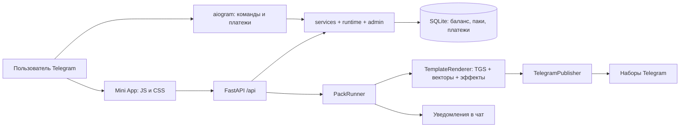

# EzzProd: техническая карта для дальнейшей работы

Дата анализа: 14 октября 2026 года. Проверена текущая рабочая копия, включая незакоммиченные изменения, а не только последний коммит `dffa8e3`.

## Текущее состояние

Это Telegram-бот с Mini App для персонализации и публикации наборов эмодзи и стикеров. Реальная сборка уже реализована. README и начальное описание `app/packs.py` отстали от кода: там ещё говорится о будущем подключении генерации и процедурных заглушках.

Проект использует Python, FastAPI, aiogram 3, aiosqlite/SQLite и Pillow. Mini App написан на обычных JavaScript ES-модулях и CSS, без сборщика и npm. TGS — gzip-сжатая Lottie-анимация: бот изменяет готовые шаблоны, превращает надписи и логотипы в векторные фигуры и отправляет результат Telegram. Генеративной ИИ-модели в этой цепочке нет.

В каталоге **343 шаблона**: classic — 144, characters — 58, gift — 34, love — 27, finance — 17, one — 16, flags — 8, other — 39. Для каждого имеется WebP-превью.

При начале анализа Git показывал 69 изменённых отслеживаемых файлов и два новых файла: `app/user_fonts.py`, `tools/bw_templates.py`. Изменения включают пользовательские шрифты, индивидуальные настройки элементов и обновление части шаблонов/превью. Не перезаписывать эти изменения и не выполнять массовый reset/checkout.

## Пользовательские возможности

- Выбор шаблонов, оформление наборов типа emoji или sticker, история паков.
- Общие и индивидуальные настройки: ник, заливка, обводка, размер надписи, логотип, собственный TrueType-шрифт.
- Живое Lottie-превью. Для обычной персонализации есть клиентская реализация; Pro-редактор использует серверный `/api/render`.
- Pro: изменение отдельных частей, цветов и анимаций; эффекты pixel, metal, glitch, holo, burst; сохранённые стили.
- Покупка генераций за Stars, рефералы, промокоды и подарок при регистрации.
- Администрирование через Mini App и `/admin` в чате: статистика, пользователи, баланс, Pro, баны, техработы, скрытие категорий, цены/лимиты, промокоды, рассылки, дополнительные админы, резервная копия БД и CSV-экспорт.

СБП, xRocket и CryptoBot перечислены в `pricing.py`, но провайдеры этих способов не подключены: `enabled_methods()` возвращает только Stars.

## Архитектура и точки изменений



FastAPI и polling бота живут в одном процессе. Общий объект `Context` соединяет обработчики бота, HTTP API, БД, сборщик, уведомления и настройки. Реальная публикация ограничена семафором: по умолчанию одновременно собираются два пака. Отдельного брокера очередей или внешнего worker нет.

| Задача | Основные файлы | Что учитывать |
|---|---|---|
| Запуск и фоновые задачи | `app/__main__.py`, `app/main.py`, `app/context.py` | Lifespan, polling, восстановление паков, сверка Stars, завершение процесса |
| Настройки | `app/config.py`, `app/runtime.py` | `.env` — база; поверх неё настройки из SQLite `kv` |
| HTTP-контракт | `app/api/routes.py`, `app/api/admin.py`, `app/api/dev.py` | Подпись, права, лимиты, JSON-коды ошибок |
| Баланс, паки и платежи | `app/services.py`, `app/pricing.py`, `app/admin.py` | Транзакции и ledger, повторные события, возвраты |
| Схема данных | `app/db.py` | Базовая схема v1, миграции до v5 |
| Каталог | `app/catalog.py`, `templates/`, `webapp/assets/thumbs/` | Имена `<category>-<NNN>.tgs`; сканирование кэшируется |
| Сборка и публикация | `app/packs.py`, `app/build/builder.py`, `app/build/publish.py` | `processing → ready/failed`, прогресс `pack_items`, повторные вызовы Telegram |
| Рендер | `app/build/render.py`, `app/lottie.py`, `app/fonts.py`, `app/vectorize.py` | Текст/логотип векторизуются; результат ограничен размером TGS |
| Pro-редактор | `app/editor.py`, `webapp/js/views/editor.js` | Серверная валидация `edit`; превью и экспорт используют общий серверный код |
| Файлы пользователя | `app/logos.py`, `app/user_fonts.py` | Владение, квоты, сохранность файлов для фоновой сборки |
| Клиентский API и состояние | `webapp/js/api.js`, `webapp/js/store.js`, `webapp/js/tg.js` | Сервер — источник баланса/прав; localStorage — удобства пользователя |
| Навигация и экраны | `webapp/js/main.js`, `nav.js`, `views/` | Вкладки home/packs/profile/admin, overlays, очистка подписок |
| Клиентское превью | `webapp/js/tgs.js` | Часть алгоритмов дублирует `app/lottie.py`: менять согласованно |
| Команды и админка чата | `app/bot/handlers.py`, `app/bot/admin_panel.py` | Права, FSM, колбэки и уведомления |
| Сверка платежей | `app/reconcile.py` | Общий `settle_payment`; до 20 000 транзакций за проход |
| Временный публичный адрес | `app/public_url.py`, `tools/tunnel.py`, `tools/run-public.ps1` | Есть обновление URL на лету и более старый запуск с перезапуском процесса |

Основные HTTP-группы: `/api/me`, `/onboarding/complete`, `/categories`, `/templates`, `/glyphs`, `/render`, `/logos`, `/fonts`, `/packs`, `/styles`, `/pricing`, `/billing`, `/referral`, `/emoji`, `/admin`. `/api/dev/pay` подключается только в DEV_MODE. Каталог и известные декоративные эмодзи имеют публичные маршруты; действия пользователя требуют авторизации.

## Данные и запуск

На Windows рабочие данные по умолчанию находятся в `%LOCALAPPDATA%\EzzProdBot`: `.env`, `ezzprod.sqlite3`, логотипы, шрифты и кэш. Окружение запуска — `%LOCALAPPDATA%\emoji-bot-venv`. `DATA_DIR` и `ENV_FILE` позволяют выбрать другое расположение. На других ОС папка данных по умолчанию — `emoji-bot/data`.

SQLite использует WAL, `synchronous=FULL`, foreign keys и одно соединение с asyncio-блокировкой. Не переносить живую БД в синхронизируемую OneDrive-папку и не копировать только основной файл, игнорируя WAL. Для целостного снимка есть `Database.backup_to()` / `VACUUM INTO`. Для полного восстановления сервиса нужны также логотипы и шрифты: резервная копия БД их не включает.

Режимы:

- Локальный просмотр: `DEV_MODE=1`, loopback HOST, пустой либо локальный WEBAPP_URL; обход подписи ограничен локальным клиентом без forwarding-заголовков.
- Демо в Telegram: `DEV_MODE=0`, `DEMO_MODE=1`, `PAYMENTS_LIVE=0`, токен и публичный HTTPS-адрес.
- Реальная сборка: `DEV_MODE=0`, `DEMO_MODE=0`, BOT_TOKEN и публичный HTTPS-адрес. Stars включаются отдельно через `PAYMENTS_LIVE`.

По умолчанию DEMO_MODE включён, реальные платежи выключены. Наличие реализаций в репозитории не доказывает, что они включены у работающего бота: реальный `.env`, рабочая БД и Telegram-аккаунт в рамках анализа не инспектировались.

Для запуска предусмотрены `run.bat`, `run-public.bat` и `python -m app`. Docker/CI/deployment-конфигурация в проверенной структуре отсутствует. Архитектура рассчитана на один экземпляр приложения: несколько uvicorn workers одновременно запустят polling и восстановление одной очереди.

## Правила бизнес-логики, которые нужно сохранить

1. Одна генерация оплачивает один выбранный элемент, а не весь пак. Стоимость — количество уникальных template IDs. Списание и создание пака выполняются в одной транзакции.
2. Баланс меняется через `_apply()` с записью в `ledger`; `UNIQUE(reason, ref)` делает операции идемпотентными. Отрицательный баланс запрещён. При старте проверяется совпадение баланса с журналом.
3. `Idempotency-Key` предотвращает повторное списание за создание пака. Один ключ должен означать одну попытку/один запрос; сейчас сравнение тела повторного запроса с первоначальным не производится.
4. Платёж дедуплицируется по `(provider, charge_id)`. Несоответствие пользователя, суммы, валюты или заказа попадает в `needs_review`. Другой реальный платёж по тому же счёту не должен теряться.
5. При полном сбое пака генерации возвращаются. При частичном результате сборщик возвращает генерации за неудачные элементы и отдаёт ссылку на созданный набор.
6. Pro по умолчанию открывается после суммарной покупки 20 генераций. Ручная выдача Pro есть, но следующая покупка/возврат пересчитывает тариф по `purchased_total`; отдельный бессрочный ручной entitlement не хранится.
7. Реферальная награда выдаётся один раз после двух событий: готовый пак и хотя бы одна покупка. Лимиты 10/30 — количество наград, не сумма генераций. При суточном лимите награда остаётся неначисленной, но повторно проверяется лишь на следующем событии покупки/завершения пака этого приглашённого; отдельного планировщика отложенных наград нет.
8. Проверку подписи `initData`, владельца файла, Pro и административных прав нельзя переносить исключительно в клиент. Админы из SQLite проверяются через `runtime.is_admin()`.
9. Файлы, на которые ссылается собирающийся пак, должны оставаться доступными после удаления из пользовательской библиотеки.
10. Новые изменения схемы добавляются миграциями. Стартовые цены и подписи кнопок должны оставаться согласованными с серверным расчётом.

## Найденные проблемы: воспроизведено

### P1: повтор добавления после потерянного ответа Telegram создаёт дубль

`app/build/builder.py:125,174`: `_retry()` повторяет `publisher.add()` после сетевой ошибки. Если Telegram добавил элемент, но ответ потерялся, следующий вызов добавляет его ещё раз. Сверка количества элементов выполняется только в начале `_build()`, а не между этими повторами. Аналогичная неопределённость есть при создании первой пачки: создание могло пройти, а повтор уже столкнётся с существующим именем набора.

Локальное воспроизведение с фальшивым Publisher: запрос на **51 элемент**, первая пачка 50, первый `add` добавляет элемент и имитирует потерю ответа. Получено **52 опубликованных элемента**, при этом в БД `done=51`. Ledger остаётся согласованным, поэтому проверка баланса эту ошибку не обнаруживает. Реальные публикации не выполнялись.

Направление исправления: обрабатывать неопределённый исход create/add отдельно; перед повтором сверять состояние набора и отмечать уже выполненную операцию. Добавить тесты потери ответа после принятия запроса и исчерпания сетевых повторов при частично готовом наборе. Сейчас обычная сетевая ошибка после исчерпания повторов не попадает в обработчик частичного результата `except SetLevelError` и может привести к полному возврату за уже опубликованные элементы.

### P1: удаление логотипа отдельного элемента ломает персонализацию собирающегося пака

`app/logos.py:117`: проверка использования ищет logo_id только в общих `packs.params`. Индивидуальный логотип находится в `pack_items.params` и не учитывается. В `app/user_fonts.py` аналогичная проверка уже охватывает оба источника.

Локальное воспроизведение: создать `processing`-пак с логотипом только в overrides и удалить логотип через серверную функцию. Файл `.vec.json` удалён, несмотря на ссылку из собирающегося элемента. `load_vectors()` затем возвращает пустой список, поэтому результат может выйти без выбранного логотипа, а не с явной ошибкой.

Направление исправления: учитывать `pack_items.params`, как для шрифтов; в дальнейшем предпочтительно фиксировать ресурсы сборки или хранить проверяемые ссылки на них. Нужен тест удаления логотипа во время сборки с индивидуальными параметрами.

## Найденные проблемы: установлено по коду

### P1: включение оплаты через /admin не запускает сверку Stars

`app/main.py:179` запускает `reconcile_loop()` только если `payments_live` был включён в исходном объекте `settings` при старте. `runtime.set_setting()` меняет `ctx.settings`, но не создаёт эту задачу. Если запуск состоялся с PAYMENTS_LIVE=0, а потом админ включил оплату, счета и pre_checkout начнут работать, но периодическая сверка не появится до следующего запуска с включённой исходной настройкой. Настройка оплаты, сохранённая в `kv`, также не используется в этом условии.

Направление исправления: после загрузки runtime-настроек запускать единый жизненный цикл сверки либо держать постоянную задачу, которая учитывает актуальные настройки. Отключение выдачи новых счетов не должно мешать обработке уже полученных платежей.

### P1: миграции не атомарны и плохо переживают прерывание

`app/db.py:212–222`: несколько `executescript()` изменяют схему, а `PRAGMA user_version` записывается только после всех миграций. `BEGIN/COMMIT` вокруг миграций нет. Если процесс прервётся после одного из ALTER TABLE, при новом запуске та же миграция повторит уже применённый ALTER и получит duplicate column. Это риск доступности при обновлении, не наблюдавшееся повреждение рабочей БД. Дополнительно воспроизведено на SQLite в памяти с SQL текущего проекта: применение v2 без записи нового user_version и повтор дают `duplicate column name: set_name`, номер версии остаётся 1.

Направление исправления: выполнять каждую миграцию вместе с обновлением её номера в одной транзакции и проверять сценарий принудительного сбоя посередине. Перед обновлением рабочей БД делать целостный бэкап.

### P2: пустой каталог ломает загрузку клиента

`webapp/js/main.js:152` обращается к `state.categories[0].id`. Если админ скрыл все категории либо каталог пуст, boot завершится TypeError. Нужен отдельный экран пустого каталога; предвыбор `classic-001` и `isKnownTemplate()` также предполагают стандартную структуру каталога.

### P2: возврат определяет «не потрачено» по общему остатку

`services.begin_refund()` проверяет общий баланс через списание qty. Купленные и бесплатные генерации не разделены. Если купленные потрачены, но оставшихся подарочных/реферальных хватает, автоматический возврат всё ещё возможен. Это ограничение текущей экономической модели; решение — отдельно учитывать остатки покупок либо явно принять такую взаимозаменяемость.

### P2: состояние сервиса видно неполно

`/healthz` всегда возвращает `{ok: true}`. Это проверка веб-процесса, а не готовности polling, публикации и оплаты. При смерти polling новые счета отключаются, но задача сама не перезапускается. Для размещения на сервере полезны readiness-статус, надзор за polling, блокировка второго экземпляра и контролируемая остановка фоновых задач.

### P2: квоты файлов проверяются вне транзакции сохранения

В `save_logo()` и `save_font()` проверка количества и INSERT разделены обработкой/записью файла. Несколько параллельных загрузок могут одновременно пройти проверку и превысить квоту. При сбое INSERT уже записанные файлы остаются без записи в БД. Нужны резервирование квоты и уборка неиспользуемых файлов, если функция станет активно использоваться.

## Что уже хорошо защищено

- Проверка HMAC initData, возраста подписи и локального dev-режима.
- Транзакционный баланс, дедупликация платежей, идемпотентное создание паков, повторяемые операции возврата.
- Ограничение тела запроса на уровне ASGI, включая запросы без Content-Length; квоты файлов и проверка формата изображений.
- Серверные проверки владельца логотипа/шрифта и Pro.
- Статическая раздача ограничена `webapp/`; есть CSP и другие защитные заголовки.
- Логирование скрывает токены, включая traceback; uvicorn в штатном запуске использует общие обработчики.
- Восстановление processing-паков при старте и сторож раз в минуту; отдельно обрабатываются ошибки записи результата и уведомления.
- Реферальная награда требует покупки; шрифты загружаются после первого показа клиента; истечение сессии имеет централизованную обработку.

Это не означает полного аудита безопасности или доказательства корректности всех внешних сценариев. Старый `docs/REVIEW.md` полезен как история, но многие его замечания уже исправлены: переносить их в новую задачу без сверки с кодом нельзя.

## Проверка этой рабочей копии

- Python 3.14.3, существующее окружение `%LOCALAPPDATA%\emoji-bot-venv`.
- Сбор тестов: 201 тест.
- Полный запуск тестов: **201 passed, 1 warning, 117,60 секунды**. Предупреждение — StarletteDeprecationWarning о текущем использовании httpx в TestClient; это не сбой тестов.
- Синтаксис 57 Python-файлов app/tests/tools проверен через AST.
- Все 343 TGS распаковываются как JSON, имеют размер холста 512×512, положительный framerate и длительность не больше 3 секунд. Максимальный размер исходного gzip-файла — 59 206 байт; пропущенных WebP-превью нет. Это базовая структурная проверка, не визуальная оценка и не приёмка Telegram.
- Две новые проблемы выше воспроизведены на временной БД/фальшивом Publisher; настоящие Telegram-запросы, платежи и рассылки не выполнялись.
- Тесты в песочнице зависали до кода приложения при создании внутреннего loopback-сокета Windows asyncio. Для проверки использовался запуск вне этого ограничения, с `ENV_FILE` на несуществующий файл, `with_bot=False`/фальшивым Telegram и временными данными.
- Реальная конфигурация, рабочие пользовательские данные, визуальный интерфейс в Telegram и опубликованные наборы не проверялись.

Команда повторного запуска из `emoji-bot/` в PowerShell:

```powershell
$env:ENV_FILE = Join-Path (Get-Location) '.analysis-no-env'
$env:PYTHONDONTWRITEBYTECODE = '1'
$env:PYTEST_DISABLE_PLUGIN_AUTOLOAD = '1'
& "$env:LOCALAPPDATA\emoji-bot-venv\Scripts\python.exe" -m pytest -q -p pytest_asyncio.plugin -p no:cacheprovider
```

Эти переменные нужны для изоляции анализа; в обычном запуске бота ENV_FILE должен указывать на реальные настройки либо быть не задан.

## Порядок следующей работы

1. Сохранить и проверить текущие изменения пользовательских шрифтов и шаблонов; обновить README и описание режимов под фактическую реализацию.
2. Исправить потерю ответа create/add, хранение логотипов индивидуальных элементов и запуск сверки после переключения оплаты. Сначала добавить воспроизводящие тесты этих сценариев.
3. Сделать миграции атомарными и проверить обновление существующей БД на копии.
4. Проверить полный цикл на отдельном тестовом боте: /start, Mini App, кириллица и собственный TTF, индивидуальный логотип, emoji/sticker, прерывание и восстановление сборки, Stars и возврат.
5. Для постоянной эксплуатации подготовить один экземпляр сервиса, домен/HTTPS, автоматический перезапуск, наблюдаемость и резервные копии БД вместе с ресурсами пользователей.

Для небольших дальнейших доработок архитектуру можно сохранять. Главная сложность проекта — согласовать клиентское превью, серверный рендер, фоновые операции Telegram и денежный журнал при неполных сбоях. Сначала укреплять эти границы; переписывание всего Mini App или переход на микросервисы для этого не требуется.
